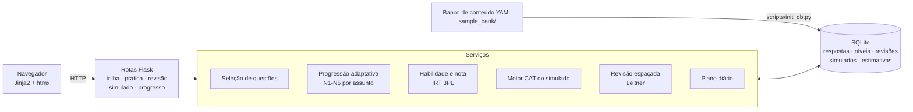

# GMAT Focus Trainer

> **English summary.** A personal, adaptive study platform for the GMAT Focus Edition, built with AI assistance
> (specified with Claude, implemented with Claude Code). It serves questions on a 5-level difficulty scale anchored
> to the real score bands, promotes or demotes each topic from your recent results, flags weak topics, schedules
> spaced-repetition reviews of mistakes, and runs timed mock exams with an IRT-based computerized adaptive test (CAT).
> Python + Flask + SQLite, server-rendered with htmx, 55+ automated tests. This repository ships a small bank of
> **original sample questions**; the author's full personal bank stays out of the repository.

Plataforma de estudo adaptativa para o **GMAT Focus Edition**, rodando localmente com Python e SQLite. Cobre a
preparação inteira: trilha de teoria, testes de fixação, prática adaptativa por assunto, revisão espaçada, caderno de
erros, simulados no estilo CAT e estimativa de nota.

**Demo:** https://gmat-focus-trainer.onrender.com (banco de exemplo; no plano gratuito o primeiro acesso pode levar ~1 minuto)

---

## O problema

Estudar para o GMAT Focus com listas fixas de exercícios desperdiça tempo: questões fáceis demais não ensinam nada,
difíceis demais só frustram, e os pontos fracos se perdem no meio do volume. A prova real é **adaptativa** — a
dificuldade acompanha o seu desempenho —, então o treino também deveria ser.

O GMAT Focus Trainer decide **o que** estudar (os assuntos mais fracos, no ritmo que cabe até a data da prova),
**em que nível** (a dificuldade certa para cada assunto) e **quando revisar** (antes de esquecer).

## Funcionalidades

- **Progressão adaptativa de dificuldade.** Cada assunto tem seu próprio nível, de N1 (Fundamentos) a N5 (Expert),
  calibrado nas faixas reais de nota (N3 ≈ 555-645, N4 ≈ 645-705). O app promove o assunto quando você acerta ≥ 75%
  das questões recentes no nível atual (mínimo de 6 respostas) e rebaixa quando o desempenho desaba (≤ 34%). A
  seleção prioriza questões nunca vistas no nível certo ou vizinho.
- **Diagnóstico de tópicos fracos.** Assuntos com acerto abaixo de 50% (com respostas suficientes) entram na prática
  focada do plano diário com mais peso. O **caderno de erros** registra por que você errou (conceito, conta, leitura,
  tempo…) e mostra os padrões.
- **Simulado no estilo CAT.** Seções cronometradas de 45 minutos com a distribuição oficial de conteúdo, passagens de
  Reading Comprehension e conjuntos de Multi-Source Reasoning mantidos juntos, até 3 revisões de resposta por seção e
  nota estimada por **teoria de resposta ao item (IRT, modelo 3PL)**. A dificuldade fica oculta, como na prova real.
- **Acompanhamento de progresso persistido em SQLite.** Toda resposta, tempo, nível, revisão e simulado fica no banco.
  A estimativa de nota usa só a primeira tentativa de cada questão, pondera por recência e pode ser calibrada com as
  notas dos simulados oficiais que você registrar.
- **Revisão espaçada.** Questões erradas, chutadas ou lentas e flashcards das lições voltam em intervalos crescentes
  (caixas de Leitner: 1, 3, 7, 14, 30 e 60 dias).
- **Plano diário ("Hoje").** Combina revisões vencidas, lições novas no ritmo necessário para a data da prova, testes de
  fixação, prática focada e simulados semanais.
- **Todos os formatos de questão do GMAT Focus:** Problem Solving, Critical Reasoning, Reading Comprehension, Data
  Sufficiency, Table Analysis, Graphics Interpretation, Two-Part Analysis e Multi-Source Reasoning, sobre um único
  formato de resposta (sem crédito parcial, como na prova).

## Como a IA foi usada

Este projeto foi construído com IA de ponta a ponta, mas com as decisões de produto e de arquitetura do meu lado.

1. **Especificação com o Claude.** Comecei discutindo com o Claude como a prova funciona (seções, tipos de questão,
   escala de nota, algoritmo adaptativo) e o que uma ferramenta de estudo precisaria ter. Dessa conversa saiu a
   especificação: níveis ancorados na escala real, ciclo lição → teste de fixação → prática, revisão espaçada,
   simulado CAT e plano diário.
2. **Prompt de desenvolvimento.** Transformei a especificação num prompt de desenvolvimento detalhado — requisitos,
   restrições (100% local, um usuário, sem build step) e critérios de aceite — e mantive um
   [`CLAUDE.md`](CLAUDE.md) com a arquitetura e as regras do projeto para orientar o agente entre sessões.
3. **Construção com o Claude Code.** O código, os testes e as migrações foram escritos com o Claude Code em ciclos
   curtos: eu usava o app no dia a dia, descrevia o problema observado (por exemplo, "as questões estão se
   repetindo") e revisava o diagnóstico e a correção antes de aceitar.

### Decisões de arquitetura

- **Flask + Jinja2 + htmx em vez de SPA.** Renderização no servidor, sem etapa de build: menos peças para manter e
  telas que funcionam com o botão "voltar" do navegador.
- **SQLite como fonte da verdade.** Toda resposta é gravada no banco na hora; o cookie de sessão guarda só a atividade
  atual. Assim, o histórico sobrevive a qualquer fechamento do navegador e o estado do simulado é reconstruído a partir
  das respostas gravadas.
- **Níveis como espinha dorsal.** Um único inteiro (1-5) por questão, com parâmetro IRT ancorado numa faixa real de
  nota. O mesmo modelo serve para escolher questões, estimar a nota e conduzir o simulado CAT.
- **Regras explícitas e auditáveis para mudar de nível.** Promoção e rebaixamento olham só as respostas desde a última
  mudança, cada mudança é registrada com o motivo, e simulados e revisões **nunca** mexem no nível (o simulado mede,
  não treina).
- **Conteúdo em YAML, separado do código.** O banco de questões é importado de arquivos versionáveis com upsert por
  `slug`; o mesmo formato serve para o banco de exemplo público e para um banco pessoal maior fora do git.

### Como validei a lógica adaptativa

A lógica adaptativa é coberta por testes automatizados (`pytest`, 55+ testes), escritos junto com cada regra:

- **Modelo de nota (`test_ability_and_levels.py`):** a probabilidade de acerto cresce com a habilidade; acertar
  questões difíceis vale mais que acertar fáceis; a incerteza diminui com mais dados; um perfil simulado de 645 é
  estimado perto de 645; a meta 645 corresponde ao nível N4; o CAT começa no N3 e se ajusta.
- **Progressão por assunto (`test_adaptive_study.py`):** promove só com evidência suficiente e nova a cada nível;
  questões mais fáceis não contam para promoção; rebaixa quando o desempenho recente desaba; simulados e revisões
  nunca alteram o nível; a seleção prefere questões inéditas do nível vizinho a repetir uma já vista.
- **Revisão espaçada (`test_srs.py`):** acertos espaçam e "formam" o item; erros voltam para a primeira caixa.
- **Fluxos completos (`test_flows.py`):** percorre todas as telas com o cliente de teste do Flask — lição, teste de
  fixação, prática, revisão, simulado de seção com edições, simulado completo com pausa, sem repetir questão dentro do
  simulado e sem separar passagens de leitura.
- **Banco de conteúdo (`test_content_bank.py`):** valida o formato de cada tipo de questão, confere as respostas
  numéricas com expressões calculadas (`answer_check`) e verifica que o gabarito não é previsível (letra correta
  equilibrada, alternativa certa que não é sistematicamente a mais longa).

Além dos testes, usei o app no meu próprio estudo e conferi o comportamento nos dados reais do SQLite — foi assim, por
exemplo, que encontrei e corrigi um caso em que a prática repetia questões antigas enquanto havia questões inéditas
um nível acima.

## Arquitetura



| Camada | Onde fica |
|---|---|
| Modelos (SQLAlchemy) | `app/models/` |
| Rotas e telas | `app/routes/`, `app/templates/` |
| Lógica adaptativa | `app/services/` (`question_selector`, `adaptive_study`, `ability`, `cat_engine`, `srs`, `study_plan`) |
| Escala de níveis | `app/levels.py` |
| Migrações (Alembic) | `migrations/` |
| Conteúdo de exemplo | `sample_bank/` (formato em [`sample_bank/README.md`](sample_bank/README.md)) |

## Banco de questões

O repositório inclui um **banco de exemplo com 68 questões e 16 lições originais**, escritas para este projeto, que
cobrem as 3 seções, os 6 tipos de questão e os 5 níveis. Ele basta para experimentar todas as telas.

O banco que uso no meu estudo é bem maior e fica **fora do repositório** (pasta `content_bank/`, no `.gitignore`).
Material oficial do GMAT (GMAC/Official Guide) e de cursos pagos tem direitos autorais e não deve ser publicado; o app
permite cadastrar esse tipo de questão para uso pessoal, sempre no banco local. O app escolhe o banco assim: a
variável `GMAT_CONTENT_DIR`, se definida; senão `content_bank/`, se existir; senão `sample_bank/`.

## Como rodar localmente

Requer Python 3.12.

```bash
git clone https://github.com/LudmilaGuedes/gmat-focus-trainer.git
cd gmat-focus-trainer

python -m venv .venv
.venv\Scripts\activate            # Windows (macOS/Linux: source .venv/bin/activate)
pip install -r requirements-dev.txt

python scripts/init_db.py         # cria o banco SQLite vazio e importa o banco de exemplo
python run.py                     # http://127.0.0.1:5000
```

`init_db.py` aplica as migrações, carrega a taxonomia e importa as questões; pode ser rodado de novo a qualquer
momento (é idempotente). Seu progresso fica em `instance/gmat_trainer.sqlite3`.

Testes:

```bash
pytest
```

Variáveis de ambiente opcionais: `SECRET_KEY`, `DATABASE_URL`, `GMAT_CONTENT_DIR`, `FLASK_DEBUG` (padrão `1` no
`run.py`) e `DEMO_MODE` (desliga o painel de curadoria `/admin`, usado na demo pública).

### Uso no dia a dia

1. **⚙ Configurações:** data da prova, nota-meta e minutos por dia.
2. **Hoje:** faça as tarefas de cima para baixo (revisões, lições novas, testes de fixação, prática focada, simulados).
3. A cada erro, marque **por que errou**; o **caderno de erros** mostra os padrões.
4. Em **Progresso**, registre as notas dos simulados oficiais para calibrar a estimativa.

O **Guia** (no menu) explica a prova, os níveis e o método.

## Demo pública (Render)

O `Dockerfile` sobe o app com o banco de exemplo, em modo demo, e o [`render.yaml`](render.yaml) publica esse
contêiner no plano gratuito do Render. Passo a passo em
[`docs/deploy-render.md`](docs/deploy-render.md). Na demo o banco SQLite é compartilhado entre visitantes e recriado a
cada deploy; no plano gratuito o app "dorme" após ~15 minutos sem uso e leva cerca de 1 minuto para acordar.

## Licença

Código sob a licença [MIT](LICENSE). As questões e lições do `sample_bank/` são originais e seguem a mesma licença.
